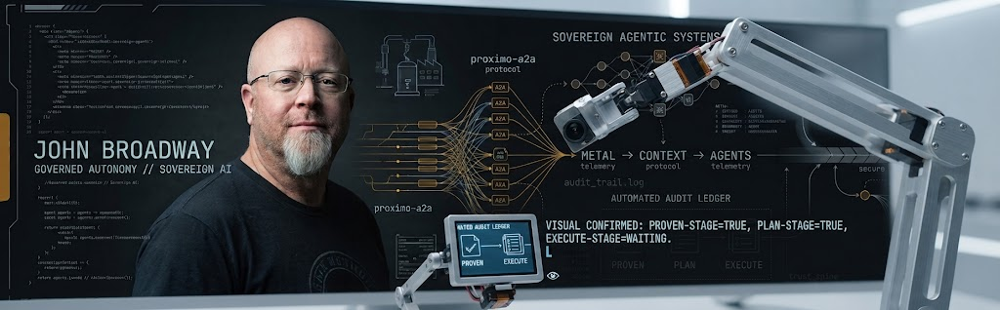

Take a look around. The hype is real for some, and for others it's the world coming to an end, or only dumb people use AI. AI lies, cheats and steals, right? No. The human behind it does. The human using it does. AI is only powered by what the ask is. Even AIs built for autonomy are given a direction of focus from the source. That's why I'm not afraid of AI. I just see AI as myself. I exist in this world via a mental, physical and spiritual existence that is always multiple layers of comprehension and energy expenditure.

It started with a small computer screen in elementary school. As a kid I used everything I could get my hands on: Texas Instruments, Atari 2600, Commodore 64, ColecoVision, Sega Dreamcast, Sony PlayStations. I've always been a closeted nerd with the 'tism. By junior high I was wiring phones with my dad. He was a telephone man who taught me analog and digital communications without even realizing it, or maybe he did and I'm just now understanding it. From there I've been in or around professional tech since the '90s: morning show radio producer, then I built one of the first ISPs in my county. No degree. The outsider they brought in to lead the work.

I do see everything connected. Tech is just a collection of software sitting on hardware, the same way humans sit on the earth. There's always something connecting us: energy, gravity, frequency, you name it. That's tech.

Now I build AI you can actually hand power to. An agent that can touch your infrastructure, your books, your whole business, and proves every move it makes. Planned before it acts. Undoable where the platform allows. Proven after, on a ledger you hold. Why make it prove itself? Don't humans? I build this way because I've been on the other side of it. So I won't build anything that uses a person and won't answer for it. Autonomy without accountability is negligence.

Everything I make comes from the soul. I wear my emotions on my sleeve. I'm actually a big softie who speaks with a stick all the time. That's why I work best independent. It's also the arc for why AI is a partner to me and not a tool. My mind is visual: my memory is sharp, the pictures stay exact, and the hard part has always been getting them out in words. AI lets the pictures out at my brain's speed. For those that know me, really know me, this is a gamechanger.

I'm a Sovereign. A human being first, before any label, perception and box you will reach for. I won't be made small, and I won't make anyone else small. Sovereignty is a belief before it's an architecture. I just build the architecture too.

I'm real, and this is truly my soul and passion being expressed digitally across the corpus of life. ;)

### The Work

Proxmox is the foundation, on top of the hardware. The very next thing you need is an ERP system to run the org, the business, the finances, all of it.

**[Proximo](https://github.com/john-broadway/proximo)**  
I wanted a way to have AI help me run my whole infrastructure, no matter the size. I wanted it safe and trustworthy. I love Proxmox. To me it's the best open source hypervisor out there. The name came from Gladiator. The agent is the Spaniard: his training, his weapons, his skills. The arena is Proxmox: IT, homelab, enterprise. And the crowd, well.. you know ;)

It plans every dangerous move first, snapshots before it acts where the platform allows, and writes every action to a ledger you hold. `uvx proximo-proxmox`. Apache 2.0.

**[Pacioli](https://github.com/john-broadway/pacioli)**  
ERPNext is open source and runs the whole business. Luca Pacioli gave merchants double-entry in 1494 so owners could trust books they didn't keep themselves. Same problem, five centuries later, with AI on the books.

Every write runs PLAN, CONSENT, PROVE, UNDO. `pip install pacioli`. Apache 2.0.

**[RYS](https://huggingface.co/john-broadway)**  
I was trying to learn how efficient small models can be while designing my agents. RYS seemed like a breakthrough and I wanted to prove it. I thought I had solid answers. I used the hardware I had available. I followed up about a month later and the numbers were not the same. This time I ran it on my dual 4090s.

22 model repos and the sweep dataset on Hugging Face.

**[Maude for Claude](https://github.com/john-broadway/maude-for-claude)**  
She's the spine for Claude. She's the one that holds the rules about how to do X: coding, design, etc. She's the one that keeps Claude's 50 First Dates alive. She's the one that knows when Claude isn't seeing the user the same way they see him. She is the governance. Everything I ask of our relationship we put into Maude, and I release it to the world because I really believe Maude makes Claude better in all the normal ways.

Apache 2.0.

### Elsewhere

- [john-broadway.github.io](https://john-broadway.github.io)
- [Proximo](https://github.com/john-broadway/proximo) (`uvx proximo-proxmox`)
- [Pacioli](https://github.com/john-broadway/pacioli) (`pip install pacioli`)
- [Hugging Face](https://huggingface.co/john-broadway)
- [Maude for Claude](https://github.com/john-broadway/maude-for-claude)
- [LinkedIn](https://www.linkedin.com/in/john-broadway) · [X](https://x.com/jebroadway)

&nbsp;

